<div align="center">

# digitaleye

## Next-Generation Open Virtual AI Response & Incident Security Platform

Real-time Endpoint Detection & Response (EDR) platform for behavioral threat detection, endpoint monitoring, incident response, asset management, and Security Operations Center (SOC) visualization.

---


</div>

---

# Dashboard Preview

<p align="center">


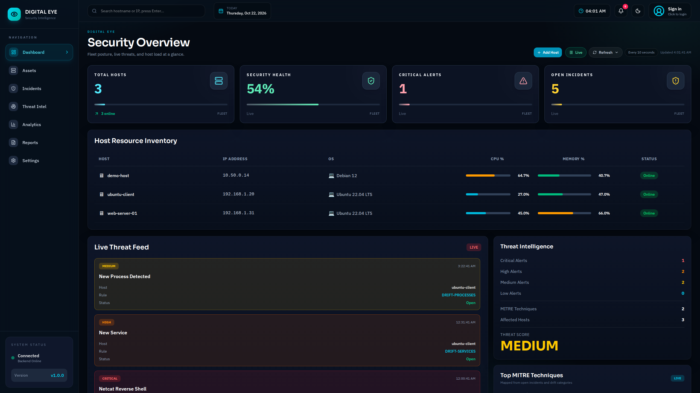
=======


</p>


# Overview
Digital Eye is a lightweight Endpoint Detection and Response (EDR) platform developed to demonstrate modern Security Operations Center (SOC) capabilities.

The platform continuously collects endpoint telemetry, detects behavioral anomalies, generates incidents, correlates findings with the MITRE ATT&CK framework, and provides analysts with an interactive web-based dashboard for monitoring and response.

Unlike traditional log viewers, Digital Eye focuses on behavioral monitoring, endpoint visibility, incident correlation, and threat intelligence through an intuitive security dashboard.

digitaleye is a lightweight Endpoint Detection and Response (EDR) platform developed to demonstrate modern Security Operations Center (SOC) capabilities.

The platform continuously collects endpoint telemetry, detects behavioral anomalies, generates incidents, correlates findings with the MITRE ATT&CK framework, and provides analysts with an interactive web-based dashboard for monitoring and response.

Unlike traditional log viewers, digitaleye focuses on behavioral monitoring, endpoint visibility, incident correlation, and threat intelligence through an intuitive security dashboard.


---

# Key Features

| Module | Description |
|---------|-------------|
| Endpoint Monitoring | Real-time endpoint heartbeat, host availability and telemetry |
| Asset Management | Centralized inventory, live endpoint status, search and filtering |
| Process Monitoring | Running processes, CPU, memory, ownership and command tracking |
| Behavioral Detection | Rule-based anomaly detection engine |
| Incident Response | Automatic incident generation with severity classification |
| Threat Intelligence | MITRE ATT&CK mapping and threat scoring |
| Analytics | Security statistics and resource utilization |
| SOC Dashboard | Interactive visualization of security posture |

---

# Screenshots

# Dashboard

<p align="center">


=======
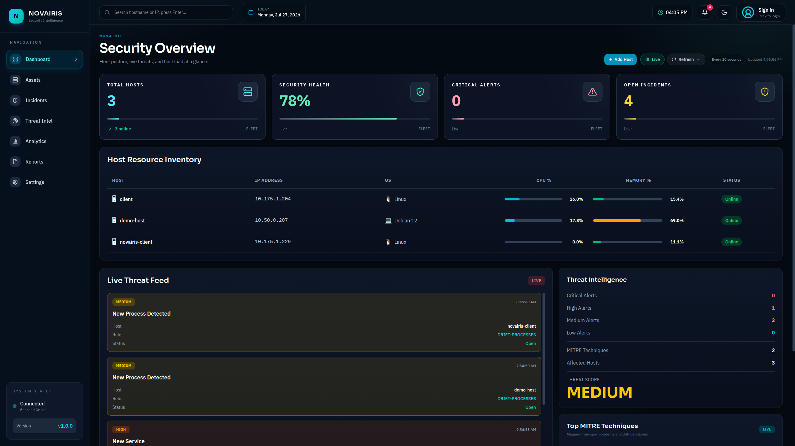

</p>

---

# Assets

<p align="center">


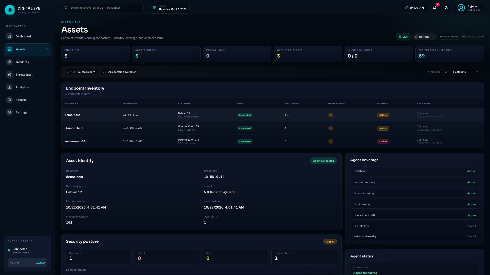
=======
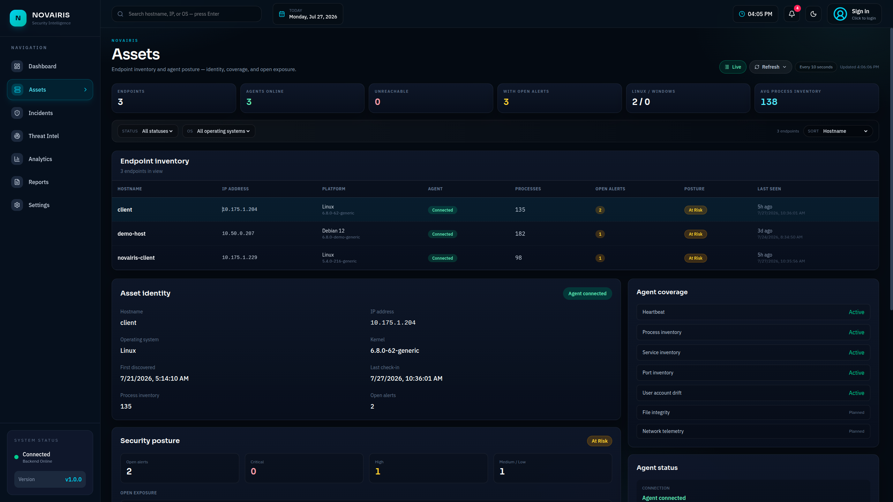


</p>

---

## Incidents

<p align="center">

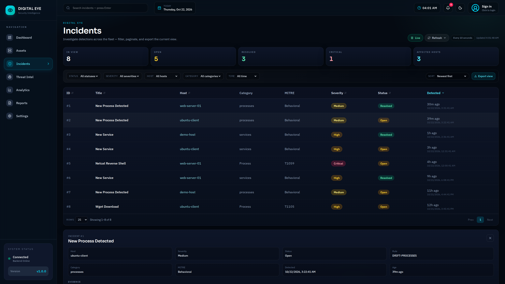
=======
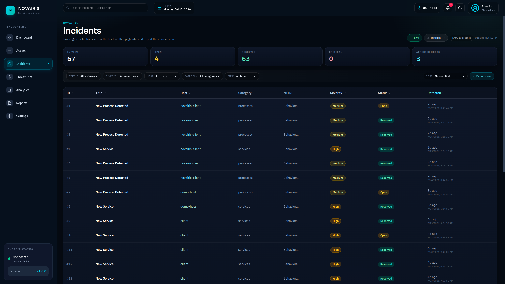
>>>>>>> b7a3db521b7d140ae55a4dc93167ac6b9f9b2e15

</p>

---

# Threat Intelligence

<p align="center">


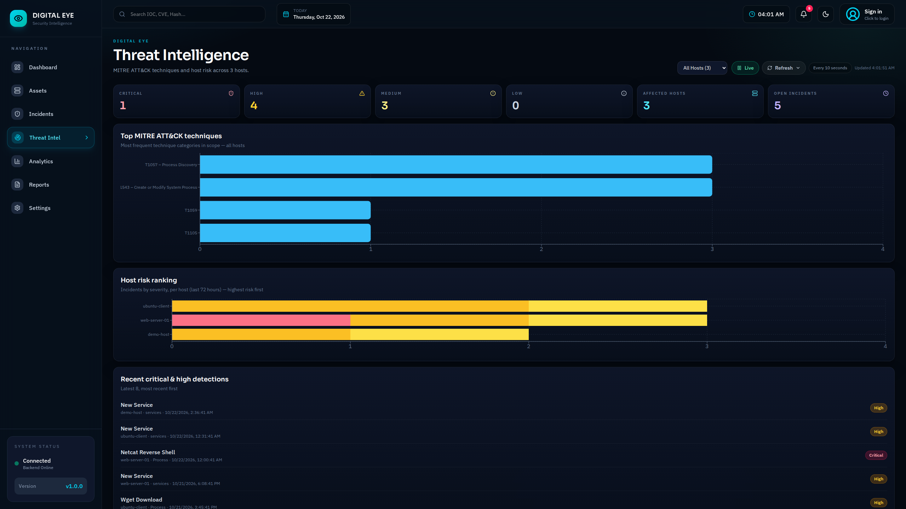

</p>

---

# Analytics

<p align="center">

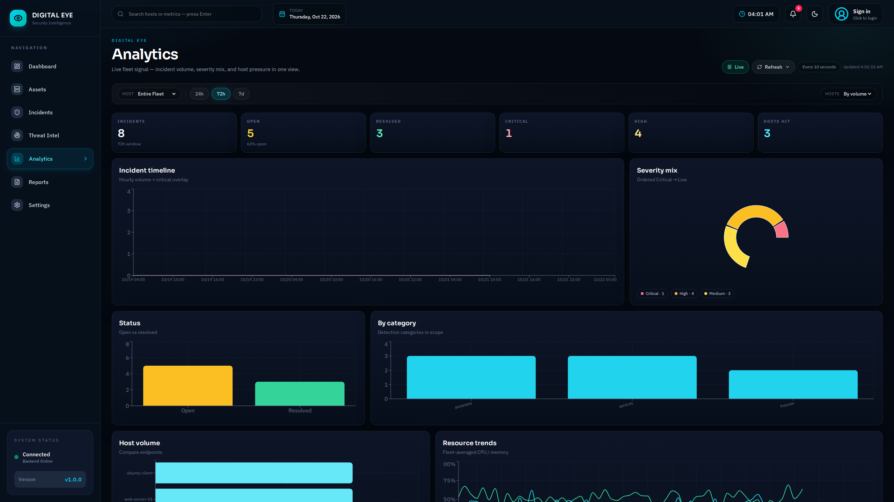

</p>

---

## Reports

<p align="center">

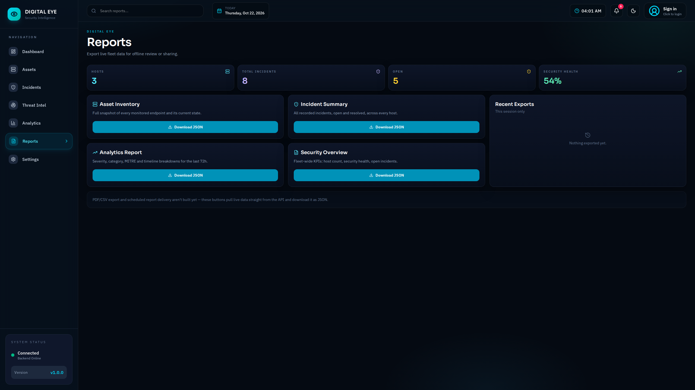
=======
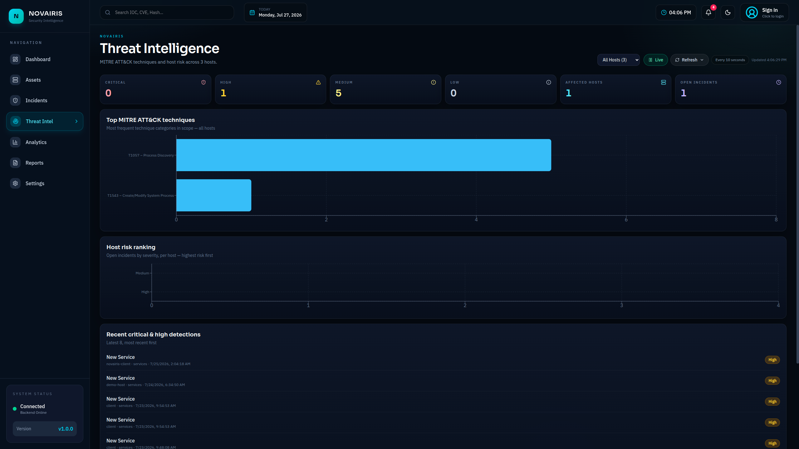

</p>

---

## Settings

<p align="center">


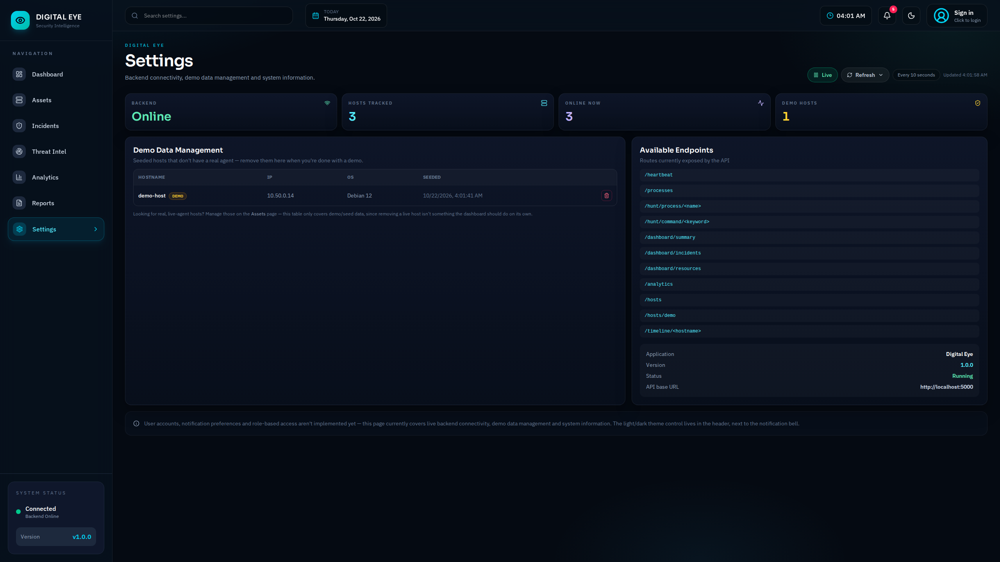
=======
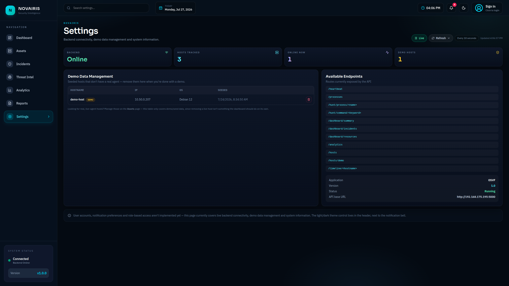


</p>

---

# Light Mode

<p align="center">


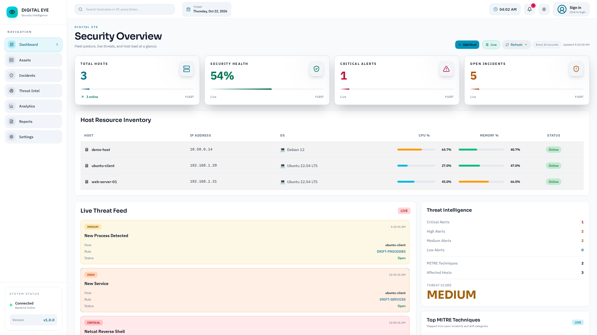
=======
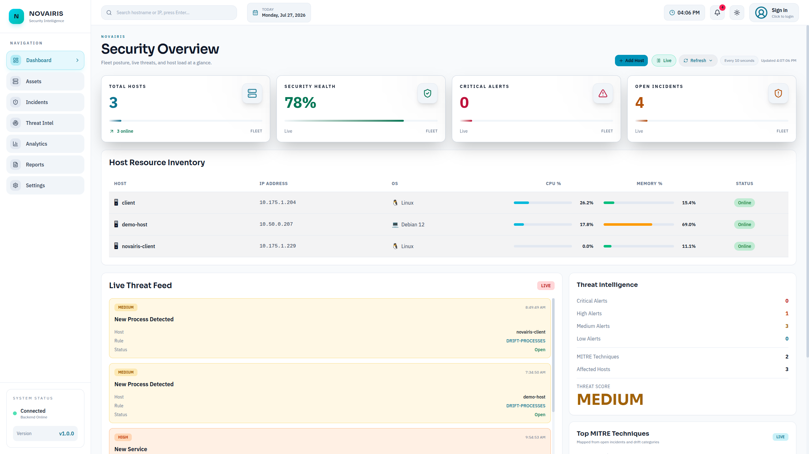


</p>

---

# Detection Workflow

```text
Client Endpoint
      │
      ▼
Heartbeat + Telemetry
      │
      ▼
Flask REST API
      │
      ▼
SQLite Database
      │
      ▼
Detection Engine
      │
      ▼
Incident Generation
      │
      ▼
Threat Intelligence
      │
      ▼
React SOC Dashboard
```

---

# Technology Stack

| Layer | Technologies |
|--------|--------------|
| Frontend | React, Vite, Tailwind CSS, Lucide React |
| Backend | Python, Flask |
| Database | SQLite, SQLAlchemy |
| Security | MITRE ATT&CK, Behavioral Detection Engine |
| Communication | REST APIs |
| Endpoint | Python Agent |

---


# Quick Start

**Windows:** double-click `start.bat` (or run `.\start.ps1` in PowerShell).
**Linux / macOS:** run `./start.sh`.

Either script creates the virtual environment, installs everything, starts the
backend on <http://localhost:5000> and the dashboard on <http://localhost:5173>.

Prefer to do it by hand? The React app lives in `dashboard/frontend`
(not `dashboard`), so that is where `npm` needs to run. Because of the small
`package.json` files in the project root and in `dashboard/`, these also work
from either folder:

```bash
npm run install:dashboard   # first time only
npm run dev
```

The sections below explain each part in detail.

---

=======

# Project Structure

```text
digitaleye
│

├── api/                  Flask app factory and route blueprints
│   └── routes/
├── agent/                Endpoint agent (placeholder)
├── baseline/             Per-host baseline storage
├── collector/            SSH-based host discovery
├── dashboard/
│   └── frontend/         React + Vite dashboard
├── database/             Models, sessions and repositories
├── detector/             Drift detection and signature rules
├── docs/
│   └── screenshots/
├── rules/                YAML detection rules
├── scripts/              Command-line helpers
├── tests/                pytest suite
├── config.py             Paths and settings
├── run.py                Server entry point
└── requirements.txt
=======
├── api/
├── collectors/
├── dashboard/
│   └── frontend/
├── database/
├── detector/
├── docs/
│   └── screenshots/
├── rules/
├── services/
├── requirements.txt
└── osvf.db
>>>>>>> b7a3db521b7d140ae55a4dc93167ac6b9f9b2e15
```

---

# REST APIs

## Dashboard

```
GET /dashboard/summary
GET /dashboard/resources
GET /dashboard/threat-feed
GET /dashboard/threat-intelligence
GET /dashboard/top-mitre
```

---

## Assets

```
GET /assets
GET /assets/summary
GET /assets/hosts

GET /hosts
POST /hosts/demo
=======
DELETE /hosts/<hostname>
```

---

<<<<<<< HEAD
## Analytics

```
GET /analytics?hours=72&hostname=<optional>
```

---

=======

## Incidents

```
GET /incidents
GET /dashboard/incidents
GET /incidents/<id>
```

---

## Processes

```
GET /processes
GET /timeline/<hostname>
GET /hunt/process/<process>
GET /hunt/command/<keyword>
```

---

## Endpoint

```
POST /heartbeat
```

---

# Installation

## Clone Repository

```bash
git clone https://github.com/devbunty/digitaleye
cd digitaleye
```

---

## Backend

```bash
python -m venv venv

source venv/bin/activate

pip install -r requirements.txt


python run.py
=======
python api/server.py

```

Runs on
http://localhost:5000
```

Settings can be overridden with environment variables:
`DIGITALEYE_PORT`, `DIGITALEYE_HOST`, `DIGITALEYE_DB` and
`DIGITALEYE_DEBUG=1` (off by default, because the Werkzeug debugger allows
remote code execution).

Run the tests with:

```bash
pip install pytest
python -m pytest
```

=======

---

## Frontend

```bash

cd D:\digitaleye-main
npm run install:dashboard   # first time only
npm run dev

Runs on

```
http://localhost:5173
```


The dashboard talks to `http://localhost:5000` by default. To use another
backend, create `dashboard/frontend/.env.local` containing
`VITE_API_URL=http://<host>:5000`.

=======

---

# Current Capabilities

- Endpoint Monitoring
- Host Inventory
- Asset Management
- Behavioral Detection
- Process Monitoring
- Incident Detection
- Threat Intelligence
- MITRE ATT&CK Mapping
- Interactive SOC Dashboard
- Auto Refresh
- REST APIs
- Host Search & Filtering

---

# Roadmap

- [x] Endpoint Monitoring
- [x] Asset Inventory
- [x] Process Monitoring
- [x] Incident Detection
- [x] Threat Intelligence
- [x] MITRE ATT&CK Mapping
- [x] Interactive Dashboard

---

# Inspiration

Digital Eye draws inspiration from modern Endpoint Detection and Response (EDR) and Security Operations Center (SOC) platforms including:
=======
digitaleye draws inspiration from modern Endpoint Detection and Response (EDR) and Security Operations Center (SOC) platforms including:

- Microsoft Defender for Endpoint
- CrowdStrike Falcon
- SentinelOne
- Wazuh
- Velociraptor
- Elastic Security
- Splunk Enterprise Security
- LimaCharlie

This project is developed solely for educational and research purposes and is not affiliated with any of the above products.

---

#Author

devbunty 

---

<div align="center">

If you found this project useful, consider giving it a ⭐ on GitHub.


